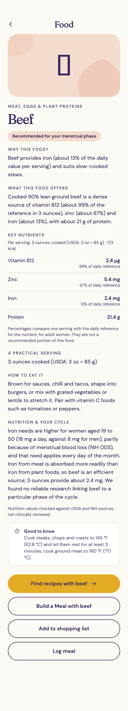
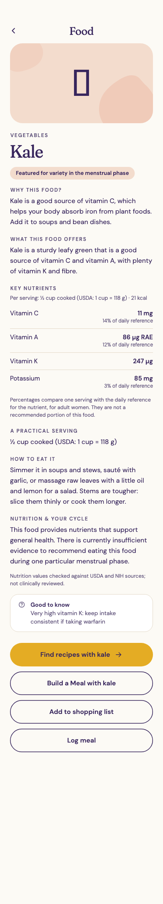
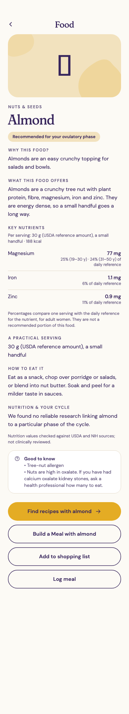
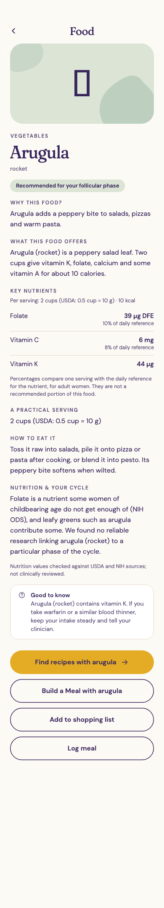
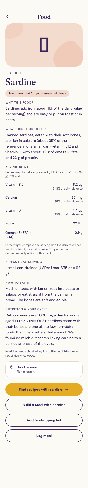
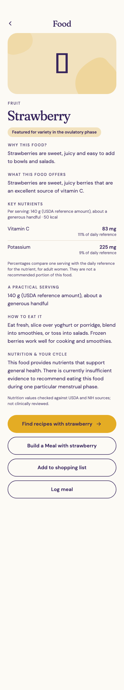

# Wave 1: final editorial approval package

**Nothing is published.** 98 profiles stay unpublished (`wave-1-candidate.json`, `publishable: false`); flax, sesame and sunflower seed stay on hold; no phase assignment changes. Details if you want them: `wave-1-approval-summary.md`, `wave-1-qa-report.md`, `why-this-food-audit.md`.

## 1. Proposed wording (exact)

- **Heading:** Nutrition & your cycle
- **Iron (only where a serving gives 10% or more):** "Women aged 19 to 50 need 18 mg of iron a day (men: 8 mg), partly because of menstrual blood loss (NIH ODS). That need applies every day of the month, not only during a period. A serving of this food has about {x} mg."
- **Closing (always; first sentence only where a serving gives a meaningful amount of a nutrient):** "This food provides nutrients that support general health. There is currently insufficient evidence to recommend eating this food during one particular menstrual phase."
- **Badge:** "Featured for variety in the {phase} phase" instead of "Recommended for your {phase} phase".
- **Label on every profile:** "Nutrition values checked against USDA and NIH sources; not clinically reviewed."

## 2. Food Detail screenshots (real app rendering, unpublished)

| Beef | Kale | Almond |
|---|---|---|
|  |  |  |
| **Arugula** | **Sardine** | **Strawberry** |
|  |  |  |

## 3. The nine "Why this food?" rewrites (production copy today, phase assignments unchanged)

Every figure was recomputed from the verified USDA serving (iron ÷ 18 mg reference). Each rewrite now names its serving.

| Food (phase) | Today | Proposed | Why |
|---|---|---|---|
| Mussel (menstrual) | Mussels are a rich source of iron (about 32% of the daily value per serving) and protein, so we highlight them during menstruation. | Mussels are a rich source of iron (about 32% of the daily value in 3 ounces cooked) and protein. | phase link removed |
| Oyster (menstrual) | Oysters are a rich source of iron (about 37% of the daily value per serving), which is why we highlight them during menstruation. | Oysters are a rich source of iron (about 21% of the daily value in six oysters). | phase link removed; stated 37% but the serving (6 medium oysters, cooked) gives 21% |
| Sardine (menstrual) | Sardines add iron (about 11% of the daily value per serving) and are easy to put on toast or in pasta. | Sardines add iron (about 15% of the daily value in one small can). | tied to a phase; stated 11% but the serving (1 small can, drained) gives 15% |
| Lentils (menstrual) | Lentils provide plant-based iron, protein and fibre, which is why we highlight them during menstruation. | Lentils provide plant-based iron (about 18% of the daily value in half a cup cooked), protein and fibre. | phase link removed |
| Quinoa (menstrual) | Quinoa adds some plant-based iron (about 12% of the daily value per serving) and is lovely in warm bowls. | Quinoa adds some plant-based iron (about 8% of the daily value in half a cup cooked). | tied to a phase; stated 12% but the serving (½ cup cooked) gives 8% |
| Spinach (menstrual) | Cooked spinach provides iron (about 18% of the daily value per serving) along with folate, which is why we highlight it during menstruation. | Cooked spinach provides iron (about 18% of the daily value in half a cup cooked) along with folate. | phase link removed |
| Anchovies (menstrual) | Anchovies are a concentrated source of iron (about 22% of the daily value per serving) and protein. | Anchovies are a concentrated source of iron, but a typical serving is small (five anchovies give about 5% of the daily value). | tied to a phase; stated 22% but the serving (5 anchovies) gives 5% |
| Banana (luteal) | Bananas are an easy addition to filling breakfasts and snacks during the luteal phase. | Bananas are an easy addition to filling breakfasts and snacks. | "during the luteal phase" had no basis |
| Honeydew melon (ovulatory) | Honeydew is soft, sweet and cooling, an easy fruit salad or snack. | Honeydew is soft and sweet, an easy fruit salad or snack. | "cooling" is a traditional claim |

## 4. What a reviewer must still do
- A real person reads the 98 profiles (or a sample you choose) and the nine rewrites against the cited sources.
- Record **their real name and the actual date** in `review.approval` in `wave-1-candidate.json`. No credential is assigned or implied by me; a professional credential is recorded only if that person actually holds one and states it.
- The label stays "not clinically reviewed" unless a qualified clinician actually reviews and says so.
- Nothing is published until you say so.

## 5. Your decisions (exact)
1. Approve the wording in section 1, or amend it. Use the plainer closing ("There isn't enough evidence to recommend eating this food in one particular phase of your cycle.")? yes / no.
2. Approve the badge change to "Featured for variety in the {phase} phase" (a production UI change plus golden updates at publication)? yes / no.
3. Approve the nine rewrites in section 3 for production? yes / no / amend.
4. Soften the phase copy in `phases.json` as listed in `why-this-food-audit.md`? yes / no.
5. Who is the real reviewer, and on what date will the review take place or did it take place?
6. Publish the 98 profiles (seed foods stay on hold)? Only on your explicit "publish".
