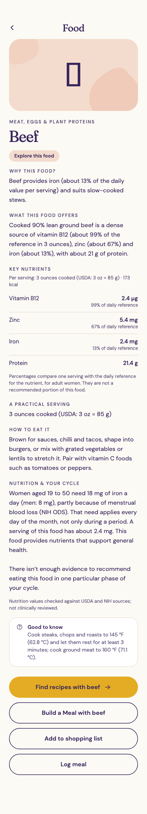
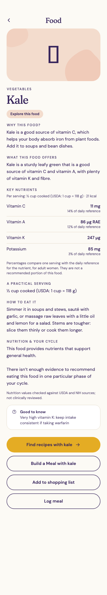
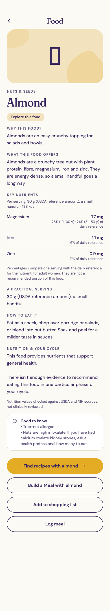
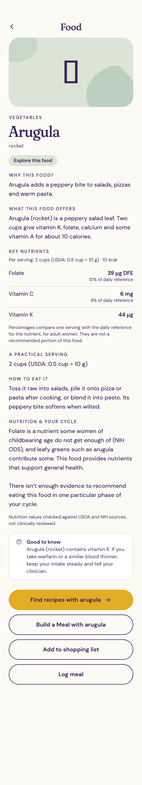
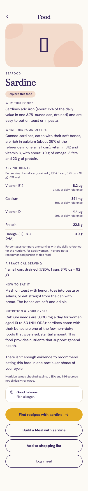
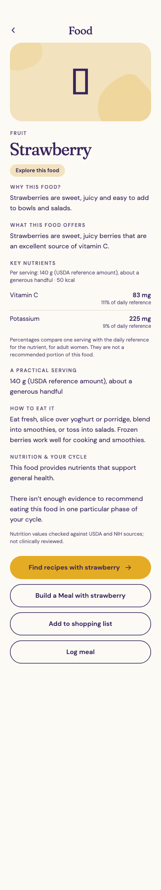

# Wave 1: final editorial approval package

**Nothing is published.** The 98 Wave 1 profiles stay unpublished (`wave-1-candidate.json`, `publishable: false`); flax, sesame and sunflower seed stay on hold; no phase assignment was changed.

## 1. Decisions applied (1 Nov 2026)

| Decision | Applied |
|---|---|
| Heading and plainer closing | Heading **Nutrition & your cycle** now shows on every profile. The evidence statement stands apart from the nutrient facts. Used in the Wave 1 candidate; added to the two live profiles that lacked one (spinach, lentils). |
| Phase badge | The pill **"Recommended for your {phase} phase"** now reads **"Explore this food"** (phase tint kept; no claim about a phase). |
| Nine rewrites | In production, after checking every sentence, serving and figure against the live USDA record (section 4). |
| `phases.json` | Softened (section 5). Menstrual physiology kept. |
| Reviewer | Role recorded as "App owner (editorial owner; not a clinician)". Name, date and credential stay empty; `finalMaterialReviewed` is false. |
| Wave 1 | All 98 unpublished; three seed foods on hold. |
| AI disclosure | Credits & Sources now has an "Illustrations" section (section 6). |

## 2. Final wording for "Nutrition & your cycle" (exact)

- **Iron (only where a serving gives 10% or more):** "Women aged 19 to 50 need 18 mg of iron a day (men: 8 mg), partly because of menstrual blood loss (NIH ODS). That need applies every day of the month, not only during a period. A serving of this food has about {x} mg."
- **Nutrient sentence (only where a serving gives a meaningful amount of something):** "This food provides nutrients that support general health."
- **Evidence statement (always, as its own paragraph):** "There isn’t enough evidence to recommend eating this food in one particular phase of your cycle."
- **Label on every profile:** "Nutrition values checked against USDA and NIH sources; not clinically reviewed."

## 3. Food Detail screenshots (real app rendering, unpublished profiles)

| Beef | Kale | Almond |
|---|---|---|
|  |  |  |
| **Arugula** | **Sardine** | **Strawberry** |
|  |  |  |

## 4. The nine "Why this food?" rewrites (diff, with verification)

Checked against the live USDA FoodData Central record for each FDC id; 18 mg iron reference from NIH ODS (Iron fact sheet, Table 1, women 19 to 50). Detail: `nine-rewrites-verification.md`. Phase assignments are unchanged.

| Food (phase) | Before | After | Verified |
|---|---|---|---|
| mussel (menstrual) | Mussels are a rich source of iron (about 32% of the daily value per serving) and protein, so we highlight them during menstruation. | Mussels are a rich source of iron (about 32% of the daily value in 3 ounces cooked) and protein. | ✓ stated 32%, computed 32% (5.71 mg of 18 mg) |
| oyster (menstrual) | Oysters are a rich source of iron (about 37% of the daily value per serving), which is why we highlight them during menstruation. | Oysters are a rich source of iron (about 21% of the daily value in six medium oysters). | ✓ stated 21%, computed 21% (3.87 mg of 18 mg) |
| sardine (menstrual) | Sardines add iron (about 11% of the daily value per serving) and are easy to put on toast or in pasta. | Sardines add iron (about 15% of the daily value in one 3.75-ounce can, drained) and are easy to put on toast or in pasta. | ✓ stated 15%, computed 15% (2.69 mg of 18 mg) |
| green-lentil (menstrual) | Lentils provide plant-based iron, protein and fibre, which is why we highlight them during menstruation. | Lentils provide plant-based iron (about 18% of the daily value in half a cup cooked), protein and fibre. | ✓ stated 18%, computed 18% (3.30 mg of 18 mg) |
| quinoa (menstrual) | Quinoa adds some plant-based iron (about 12% of the daily value per serving) and is lovely in warm bowls. | Quinoa adds some plant-based iron (about 8% of the daily value in half a cup cooked) and is lovely in warm bowls. | ✓ stated 8%, computed 8% (1.38 mg of 18 mg) |
| spinach (menstrual) | Cooked spinach provides iron (about 18% of the daily value per serving) along with folate, which is why we highlight it during menstruation. | Cooked spinach provides iron (about 18% of the daily value in half a cup cooked) along with folate. | ✓ stated 18%, computed 18% (3.21 mg of 18 mg) |
| anchovies (menstrual) | Anchovies are a concentrated source of iron (about 22% of the daily value per serving) and protein. | Anchovies are a concentrated source of iron, but a typical serving is small (five anchovies give about 5% of the daily value). | ✓ stated 5%, computed 5% (0.93 mg of 18 mg) |
| banana (luteal) | Bananas are an easy addition to filling breakfasts and snacks during the luteal phase. | Bananas are an easy addition to breakfasts and snacks. | ✓ no figure; wording only |
| honeydew (ovulatory) | Honeydew is soft, sweet and cooling, an easy fruit salad or snack. | Honeydew is soft and sweet, an easy fruit salad or snack. | ✓ no figure; wording only |

## 5. `phases.json` changes (menstrual and luteal; follicular and ovulatory unchanged)

| Field | Before | After |
|---|---|---|
| menstrual `focusBody` / `focus` | "…so Moon Cycle highlights iron-rich foods during this phase." | "…and iron is needed every day of the month, so iron-rich foods are worth including throughout your cycle; some are featured here." |
| menstrual `learnMore` | "Nourishing meals, gentle movement and restful moments can offer support." | "Meals, gentle movement and restful moments are all options." |
| menstrual `homeFocus` | "…can help you care for yourself." | "Meals, comfortable movement and moments of rest are ways to look after yourself, if they suit you." |
| luteal `learnMore` | "…calming rituals can help you feel cared for." | "…calming rituals can all have a place in your day." |
| luteal `homeFocus` | "…calming rituals can support your everyday comfort." | "…calming rituals are options for your everyday routine." |

Kept: the descriptions of low or rising estrogen and progesterone, the lining being shed, the LH surge, and the hedged "you may notice" wording. No text says a food balances hormones, detoxifies, or must be eaten in a phase.

## 6. Credits & Sources statement (exact)

"Some food and lifestyle illustrations in Moon Cycle, including the recipe images, were generated using AI. They show the idea of a dish and may differ from a recipe in small details."

## 7. Still open

1. **Reviewer:** the final material has not been reviewed by a named person. Say who reviewed it and on what date, or leave it empty. No credential is implied.
2. **Phase taglines** ("Fresh, curious & energising", "Grounded, steady & restorative") are editorial mood words, not nutrition claims. Keep or soften?
3. **Publication:** only on your explicit "publish". The 98 stay unpublished until then.
